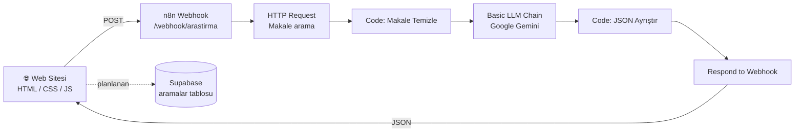

# 🗂️ Hafıza Kartları

> Konuyu yaz, makaleleri kartlarla öğren ve podcast olarak dinle.

Hafıza Kartları, kullanıcının yazdığı bir konu için akademik makaleleri bulan, her makaleyi **tek cümlelik özet, üç ana fikir ve akılda kalan bir benzetmeye** indirgeyen ve tüm sonucu **iki kişilik bir podcast diyaloğuna** dönüştüren yapay zeka destekli bir öğrenme aracıdır.

- 🌐 **Canlı site (Netlify):** https://poetic-pixie-072eec.netlify.app
- 🌐 **GitHub Pages:** https://hfsftmakky.github.io/hafiza-kartlari/

---

## 📸 Ekran Görüntüleri

| Arama | Makale Kartları | Podcast |
|---|---|---|
|  |  |  |

| Teknik Rapor | Geçmiş | n8n Akışı |
|---|---|---|
|  |  |  |

---

## ✨ Özellikler

| Sayfa | Ne yapar? |
|---|---|
| **Ara** | Konu yazılır, kullanıcı tipi seçilir (ör. Akademisyen), araştırma başlatılır. |
| **Makaleler** | Her makale bir kart: tek cümlelik özet, 3 ana fikir, sarı "Akılda kalsın" benzetmesi, etiketler, kaynak linki. |
| **Dinle** | Sunucu ve Uzman arasındaki podcast diyaloğu, sesli oynatma. |
| **Rapor** | Yönetici özeti ve teknik rapor. |
| **Geçmiş** | Önceki aramalar, tek tıkla yeniden açma (şu an tarayıcıda saklanır, Supabase entegrasyonu planlanıyor). |
| **Ayarlar** | n8n webhook adresi, demo modu, tema (otomatik / açık / koyu). |

Ek olarak: **Demo modu** (n8n erişilemezse örnek veri gösterir) ve hata durumunda **"Tekrar dene"** akışı.

---

## 🏗️ Mimari



### Veri akışı

1. Kullanıcı konuyu yazar, site n8n webhook'una `POST` isteği gönderir.
2. **HTTP Request** düğümü konuyla ilgili makaleleri çeker.
3. **Code** düğümü ham veriyi temizler ve LLM için hazırlar.
4. **Basic LLM Chain** (Google Gemini) makale kartlarını, raporu ve podcast diyaloğunu üretir.
5. İkinci **Code** düğümü model çıktısını (JSON) temizler ve doğrular.
6. **Respond to Webhook** sonucu siteye döndürür, site ekranları doldurur.
7. Sonuç **Geçmiş** sayfasında listelenir. Kalıcı saklama için Supabase entegrasyonu planlanmaktadır (aşağıda kurulum şeması hazırdır).

---

## 🧰 Kullanılan Teknolojiler

| Katman | Teknoloji |
|---|---|
| Ön yüz | HTML, CSS, JavaScript |
| Yayın | Netlify, GitHub Pages |
| İş akışı / otomasyon | n8n Cloud |
| Yapay zeka | Google Gemini (n8n Google Gemini Chat Model) |
| Veritabanı | Supabase (PostgreSQL) |
| Sürüm kontrol | Git, GitHub |

---

## 📁 Proje Yapısı

```
.
├── index.html                 # Tüm uygulama (arayüz + mantık)
├── n8n/
│   └── arastirma-akisi.json   # n8n iş akışı (API anahtarsız export)
├── docs/
│   └── screenshots/           # README ekran görüntüleri
└── README.md
```

---

## 🚀 Kurulum

### 1) Siteyi çalıştırma

Statik bir site olduğu için kurulum gerekmez:

```bash
git clone https://github.com/hfsftmakky/hafiza-kartlari.git
cd hafiza-kartlari
# index.html dosyasını tarayıcıda aç
```

### 2) n8n akışını içe aktarma

1. n8n'de **Workflows → Import from file** ile `n8n/arastirma-akisi.json` dosyasını yükle.
2. **Google Gemini Chat Model** düğümüne kendi **Gemini API anahtarını** (credential) ekle.
3. **Webhook** düğümünde yol (path) `arastirma`, yöntem `POST`, yanıt modu **Using 'Respond to Webhook' Node** olmalı.
4. Akışı **Publish** et. Production URL şu biçimdedir: `https://<hesap>.app.n8n.cloud/webhook/arastirma`
5. Webhook düğümünde **CORS / Allowed Origins** ayarına site adresini ekle.

### 3) Siteyi n8n'e bağlama

Site, varsayılan olarak `index.html` içindeki Production webhook adresine bağlıdır ve demo modu kapalıdır. Kendi n8n hesabını kullanacaksan **Ayarlar** sayfasındaki *n8n webhook adresi* alanına kendi adresini yaz. n8n olmadan denemek için **Demo modu**'nu işaretleyebilirsin.

> ⚠️ `/webhook-test/` adresi yalnızca "Execute workflow" sonrası tek istek için çalışır. Canlı kullanımda mutlaka `/webhook/` adresini kullan.

### 4) Supabase kurulumu

Supabase'de yeni proje oluştur ve SQL Editor'de şunu çalıştır:

```sql
create table aramalar (
  id          bigint generated always as identity primary key,
  konu        text        not null,
  persona     text,
  sonuc       jsonb,
  olusturma   timestamptz default now()
);

alter table aramalar enable row level security;

create policy "herkes okuyabilir" on aramalar for select using (true);
create policy "herkes ekleyebilir" on aramalar for insert with check (true);
```

Ardından **Project Settings → API** bölümünden `Project URL` ve `anon public key` değerlerini siteye / n8n Supabase düğümüne gir.

> Not: `anon` anahtarı herkese açık kullanıma uygundur, ancak `service_role` anahtarını **asla** repoya veya ön yüze koyma.

---

## 📡 API Sözleşmesi

**İstek**

```http
POST /webhook/arastirma
Content-Type: application/json

{
  "topic": "aşı",
  "target_audience": "Akademisyen"
}
```

**Yanıt (özet)**

```json
{
  "meta": { "topic": "aşı" },
  "articles": [
    {
      "title": "...", "source": "...", "year": "2019", "url": "https://...",
      "one_liner": "Tek cümlelik özet",
      "key_points": ["...", "...", "..."],
      "memory_hook": "Akılda kalan benzetme",
      "recall_q": "...", "recall_a": "...",
      "tags": ["..."]
    }
  ],
  "technical_report": {
    "executive_summary": "...", "problem_statement": "...", "methodology": "...",
    "findings_and_analysis": "...", "future_scope_and_conclusion": "..."
  },
  "visual_diagrams": [ { "id": "flow", "title": "...", "mermaid_code": "flowchart TD ..." } ],
  "audio_script": {
    "title": "...",
    "dialogue": [
      { "speaker": "Sunucu", "text": "..." },
      { "speaker": "Uzman", "text": "..." }
    ]
  }
}
```

---

## 🛡️ Hata Yönetimi

Yapay zeka ve dış servis kaynaklı aralıklı hatalara karşı alınan önlemler:

- Gemini düğümünde **Retry On Fail** (3 deneme, 3 sn aralık).
- Model çıktısındaki ` ```json ` bloklarını temizleyen ve ilk `{` ile son `}` arasını ayrıştıran **JSON temizleme** kodu.
- Başarısız düğümlerde **On Error → Continue**, böylece `Respond to Webhook` her durumda çalışır.
- Sitede istek hata verirse **otomatik olarak en fazla 3 kez** (4 sn arayla) yeniden denenir; yine olmazsa hata ekranı ve **Tekrar dene** butonu gösterilir.
- n8n erişilemezse **Demo modu** ile örnek veri.

---

## 👥 Görev Dağılımı

| Üye | Sorumluluk |
|---|---|
| **Ad Soyad 1** (@hfsftmakky) | Ön yüz (HTML/CSS/JS), arayüz tasarımı |
| **Ad Soyad 2** | n8n iş akışı, webhook, Gemini entegrasyonu |
| **Ad Soyad 3** | Supabase veritabanı, geçmiş kayıtları |
| **Ad Soyad 4** | Dokümantasyon, test, sunum |

> Her üye kendi GitHub hesabından commit atmalıdır.

---

## 🔄 Commit Kuralları

Küçük ve anlamlı commit'ler tercih edilir. Örnekler:

```
feat: konu arama ekranı eklendi
feat: n8n webhook bağlantısı kuruldu
fix: Gemini JSON çıktısı temizleme eklendi
feat: Supabase geçmiş kaydı eklendi
docs: README ve mimari şema eklendi
```

Önekler: `feat` (yeni özellik), `fix` (hata düzeltme), `docs` (dokümantasyon), `style` (görünüm), `refactor` (düzenleme).

---

## 🗺️ Yol Haritası

- [x] Konu arama ve makale kartları
- [x] Podcast diyaloğu ve rapor
- [x] Demo modu ve tema desteği
- [x] Retry ve JSON temizleme ile hata yönetimi
- [ ] Supabase ile kalıcı geçmiş
- [ ] Kullanıcı girişi
- [ ] Kartlar için çalışma / test modu

---

## 📄 Lisans

Bu proje eğitim amaçlı geliştirilmiştir.
